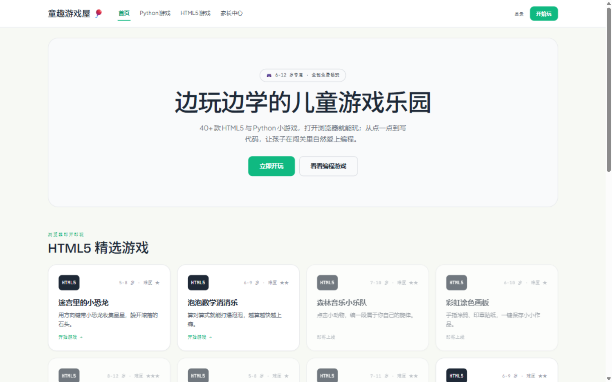
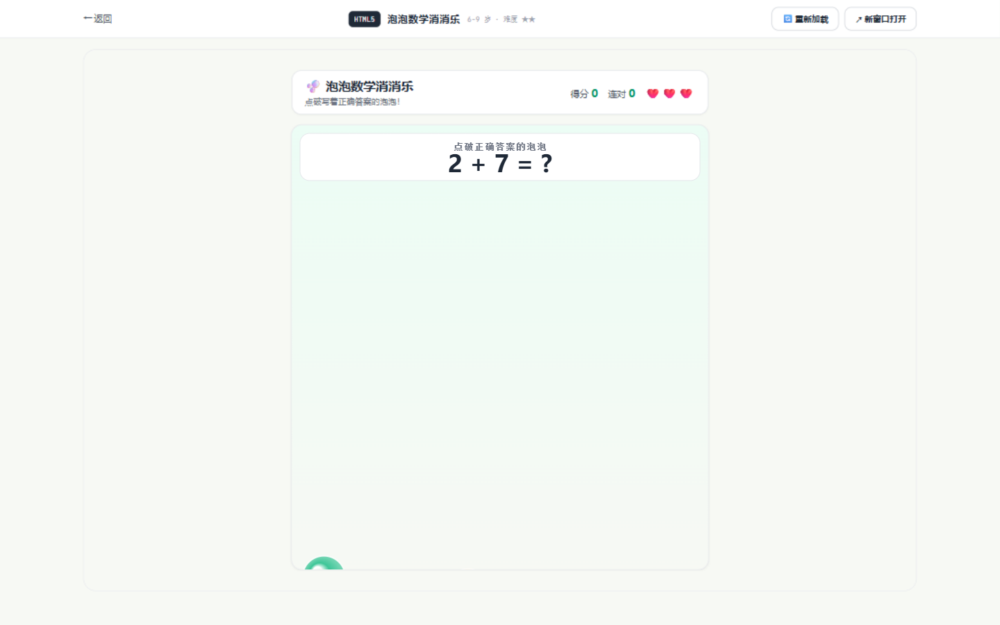
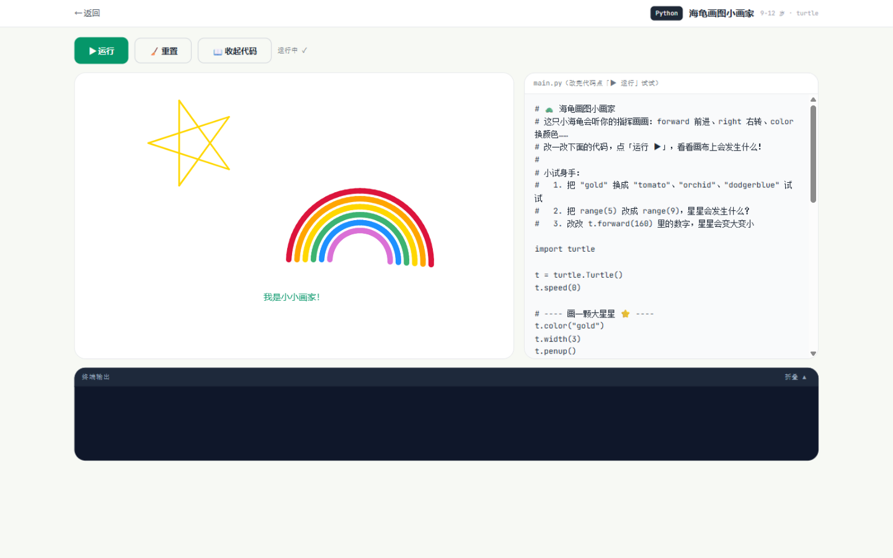
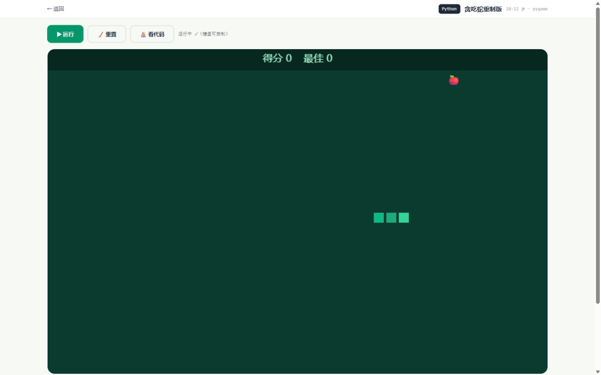

# 童趣游戏屋 🎈 —— 从一张设计模板到一个可玩的网站

这个仓库里的儿童游戏网站，**没有一行代码是手写的**：全部由 AI 编程助手
（ZCode + GLM）在对话中生成。人类只做两件事——给出一张 HTML 设计模板，
然后用日常语言提需求和反馈；助手负责方案、编码、排错和验证。
本文记录这个"以 prompt 生成工程"的完整过程。

> 工程技术细节（架构、构建、API、如何加游戏）另见 [project.md](project.md)；
> 全部交互原文在 [prompt/message.txt](prompt/message.txt)，每轮方案确认日志在 [logs/](logs/)。

## 起点：一张设计模板

一切从 `docs/童趣游戏屋 · 儿童游戏网站.html` 开始——一张 1440px 宽的静态设计稿：
顶栏导航、Hero 大标语、8 张 HTML5 游戏卡、4 张 Python 游戏卡、数据统计条、
CTA 横幅与页脚。它是"画"，还不能玩：布局是绝对定位的画板，卡片按钮没有链接，
Python 游戏更只是四行文案。



## 生成过程：六轮对话，一个网站

以下每一轮都真实发生在 `prompt/message.txt` 里（摘引用户原话），
对应的方案确认日志与 git 提交均可追溯。

### 第 1 轮：一句话需求 → 完整工程

> "根据 docs/童趣游戏屋 · 儿童游戏网站.html 下的网站模板文件，创建一个网站，
> 基于 golang+gin 框架，html5 和 python 游戏都可以 web 在线玩……
> 至少是不是前后端调用分离，这个你要帮我考虑好，html 可以用 node 编译后应用"

助手先复述需求、给出技术方案（前后端分离开发 + 单服务部署；Python 游戏用
Pyodide 在浏览器跑真 Python；首期骨架 + 6 款游戏），经确认后一次性生成：

- Go + Gin 后端（游戏清单 API、静态资源托管、SPA 兜底路由）
- Vite + TypeScript 前端（用 Node 编译，产物交给 Go 托管，正是需求里"node 编译后应用"）
- 3 款 HTML5 游戏（记忆翻翻牌、迷宫里的小恐龙、泡泡数学消消乐）
- 3 款 Python 游戏（猜数字机器人、海龟画图小画家、贪吃蛇重制版），
  含浏览器里的 Python 终端、画布与可在线编辑的代码窗口

HTML5 游戏开箱即玩（泡泡数学消消乐，点破写着正确答案的泡泡）：



Python 游戏在浏览器里加载真实 Python 源码运行，孩子能改代码立即看效果
（海龟画图小画家：左侧改代码，右侧画星星和彩虹）：



### 第 2 轮：一个 bug，两个真相

> "运行 server，浏览器打开什么内容都没有，对了，你可以做一个 makefile 文件，
> 我一次性就编译好了，生成在 output 文件夹下"

助手用 node 在本地复现了空白页根因——自写的前端路由有两处失配（根路径永不命中
导致同步递归栈溢出；其余路径因前导斜杠也全部失配），修复后顺手交付了
`Makefile`：一条 `make` 把前端、后端、游戏资源全部编译进 `output/`。

### 第 3 轮：串场的贪吃蛇

> "那个海龟画图小画家，怎么也是和第二个一样，是贪吃蛇"

用本地 Python 重放运行器逻辑后定位：Pyodide 全局命名空间在游戏之间共享，
上一局贪吃蛇的 `update`/`on_key` 残留，把海龟的画布每帧重绘成了贪吃蛇。
修复为"每次运行使用独立命名空间"，从原理上杜绝串场
（贪吃蛇自己长这样，键盘方向键直接玩）：



### 第 4 轮：换一个终端，make 就报错

> "'{' 不是内部或外部命令…… make: *** [check] 错误 1"

助手在 cmd 环境（PATH 上没有 bash）一字不差复现：原生 Windows make 回退用
cmd 执行配方，而 Makefile 里全是 Unix 命令。重写 Makefile——文件操作全部改用
node 完成，cmd / PowerShell / Git Bash / Linux 行为一致。

### 第 5 轮：布局不好看

> "游戏窗口，发送窗口和代码窗口，好像布局不好看……发送窗口好像有的游戏
> 并不需要，或是不需要那么大区域"

播放页改为按游戏类型自适应：画布类游戏画布居左、代码并排、终端降级为可折叠
的紧凑日志条，"发送"输入行只在程序真的需要输入时出现；控制台游戏则让终端
成为大窗口主角。

### 第 6 轮：截图（以及最后一个障碍）

> "这次允许你调用浏览器，然后截一部分这个网站的图和玩游戏的图"

截图过程中发现：Pyodide 运行时所在的 jsDelivr CDN 在当前网络完全停滞
（实测 0~4KB/s）。经确认改为**本地自托管**——从 npmmirror 一分钟内取回完整
运行时放进工程，加载秒级完成，国内网络也不再依赖境外 CDN。本文全部截图
即出自调整后的真实运行页面（浏览器自动化打开页面、点击"▶ 运行"、等 Python
执行完成后的实况）。

## 现在就玩

```bash
make && cd output && ./server.exe    # 打开 http://localhost:8080
```

（Python 游戏需先一次性准备本地 Pyodide 运行时，见 [project.md](project.md)。）

## 小结

从一张静态模板到"HTML5 + Python 双引擎、可玩可改代码"的网站，
共 6 轮需求对话、10+ 次 git 提交、4 个被真实反馈揪出并修复的 bug
（其中两个是"只有真机使用才能发现"的环境问题）。每一步的 prompt、
方案确认与执行记录都完整保留在本仓库中——这本身也是"AI 结对编程留痕"
的一个小样本。
